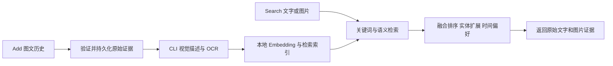

# TraceMemory 完整开发系统

2026-10-30：主服务版本 `0.3.3-system`，已在授权服务器跑通图文链路和公开真实图片小批验证。
按用户指定固定使用 `gpt-5.6-sol` 做开发期视觉理解；本地 Qwen3-Embedding-0.6B 做文本向量化。
这是可运行的开发系统，尚未完成官方评测与参评模型切换。

## 系统如何运行



没有图片的文字写入不调用 CLI。图片按批次提取检索信息，图片与源文字始终保存在原始记录中；
生成的描述和 OCR 只用于索引。Search 返回来源证据，不生成最终答案。
单张图片解码像素上限为 40MP；索引描述和事实有长度上限，实际大图/长内容效果仍需额外验证。
写入失败不会返回成功；未完成索引的原始记录不会出现在 Search 中。
相同用户、相同 request_id 的相同重试复用索引和缓存，不重复调用模型；请求体变化返回 409。

主入口是服务器 `127.0.0.1:18089`；内部 Embedding 服务是 `127.0.0.1:18088`。
公网原地址现发布无模型 `0.3.1-protocol`；旧 `0.1.0-protocol` 保留在冻结的端口 18086 和专用诊断路径。
新配置通过 18090 网关接入，平台绑定 API 要求沿用原地址，详见 `协议版本031提交说明.md`。
18087 是此前的离线候选接口，不作为完整系统的主入口。

## 已接通的能力

| 部分 | 实际实现 |
| --- | --- |
| Add | JSON、字段、角色、时间戳、内联图像校验；SQLite 持久化；索引完成才确认成功 |
| 视觉 | Codex CLI + gpt-5.6-sol，描述、OCR、实体与事实提取，最大边长 1536 的处理副本 |
| 向量 | 本地 Qwen3-Embedding-0.6B，1024 维，查询使用检索指令 |
| 检索 | BM25、向量矩阵、像素一致性、RRF；利用语义幅度校正偶然关键词干扰 |
| 长图文索引 | 原文与视觉元数据分别使用重叠窗口，不丢弃长消息尾部或 OCR；二跳扩展不叠加放大弱候选 |
| 对象与状态关系 | 独立有序证据、方向一致性；按实体和属性选择当前/历史状态；辅助证据随作用域清理 |
| 图片证据意图 | 明确找图时有限偏好语义相关的原图；不强制排除文字，不提高弱相关图片 |
| 扩展与排序 | 低频实体二跳、标识符命中、针对当前状态查询的来源时间偏好 |
| 输出 | 保留原始图文顺序与来源；图片去重；默认至多 8 张、28 MiB 解码图像 |
| 隔离 | 原始数据、模型派生缓存、词频和向量矩阵均按完整 user_id 隔离 |
| 故障恢复 | 失败索引可在重试时完成，模型失败返回 503，进程退出由 supervisor 重启 |
| 并发 | 正式模式默认 16 路请求；不同用户写入并行，同用户写入顺序；开发模式默认 2 路 |
| 用量控制 | CLI 默认最多 20 次尝试，失败尝试也计数；重启不清零，不自动改模型 |
| 数据清理 | 每小时清理超过 29 天未访问的作用域，包括原文、派生缓存和内存索引 |

API 和缓存采用独立开发目录 `data-system/development/`。来源时间戳不用于判断数据是否过期。
清理会删除 SQLite 中的原文/索引并回收删除页；不保留包含来源数据的备份。
已完成的旧协议版官方 Smoke 另有精确作用域清理计划，最迟于 2026-11-27 到期执行，
无需让邮件监控持续到该日期；正常运行的主服务会检查该私密计划。
CLI 临时图像、会话状态和日志放在独立临时目录，调用结束清除；不输出密钥或请求正文。

## 启动与维护

以下命令在服务器 `/data/wengtengjin/tracememory-aml` 中运行：

```sh
# 首次安装：项目内独立 Python 环境、固定校验的开源模型、启动服务。
bash scripts/install_system.sh

.venv-candidate/bin/python -m system_service.manage up
.venv-candidate/bin/python -m system_service.manage status
.venv-candidate/bin/python -m system_service.manage check
.venv-candidate/bin/python -m system_service.manage preflight
.venv-candidate/bin/python -m system_service.manage restart
.venv-candidate/bin/python -m system_service.manage down
```

`check` 使用自建数据，调用真实模型；后续重跑复用同一自测作用域和模型缓存。
状态和自测命令自行读取服务凭证，不将它打印出来。

私密服务配置在 `secrets/system-service.env`，权限 0600：

```text
SYSTEM_MODE=development
SYSTEM_PORT=18089
CLI_MODEL=gpt-5.6-sol
MAX_CLI_REQUESTS=20
SYSTEM_API_KEY=<由初始化脚本生成的私密凭证>
```

不需要重新购买 Embedding API。CLI 使用已有 ChatGPT 登录和对应额度；请求次数上限不是
账号剩余额度，也不是金额封顶。不得把配置文件、登录缓存或模型数据提交到仓库。

tmux 会话为 `tracememory-system` 和 `tracememory-embedding`。进程失败会自动重启；
主机或容器整体重启后，需重新执行 `manage up`。日志为项目内 `system-service.log`、
`local-embedding.log`。`down` 只停止完整 API，保留 Embedding 和其他版本供独立诊断。

## 接口

- `GET /health`：无需鉴权的存活、版本和模式信息。
- `GET /ready`：需 Bearer，检查 Embedding、视觉实际验证状态和开发尝试预算。
- `GET /status`：需 Bearer，显示模式、模型、失败/成功计数、待完成索引和预算。
- `POST /add`、`POST /search`：需 Bearer，沿用官方字段和响应结构。

开发模式只接受 `dev:` 开头的独立开发数据作用域，包括自建数据和许可明确的公开资料，拒绝正式评测数据。
它未替换申报中的公网入口。服务鉴权凭证与模型登录凭证、官方 AML Key 是三种不同凭证。

## 验证证据

- 本轮 36 项系统与路由/传输检查通过；原协议 20 项和候选 27 项的先前验证保留在历史记录中。
- 真实 CLI 在自制票据上识别出城市和编号；记录在 `system-model-validation.json`。
- 端到端检查包括文字查询、中文查询、英文同义查询、不同像素的新图查询，均返回对应源证据。
- 同时检查重复写入无额外模型调用、跨用户隔离、401、冲突 409、开发模式保护 403 和重启持久化。
- `system-flow-check.json` 是最新自测记录。重跑可能全部命中真实模型缓存，因此不能将其耗时当冷启动性能。

上述开发检查是已知自建诊断，不能证明泛化效果，也不是官方成绩。
本轮 54 条自建记录、10 个问题的前后诊断见 `多模态优化031.md`，不作为留出测试。
0.3.2 的新旧诊断、关系匹配、状态更新和限制见 `多模态优化032.md`；新增组为 51 条记录、15 个问题。
0.3.3 的真实图文小批、唯一一次留出结果及失败分析见 `真实图文验证033.md`。
6张真实图片与34条编目文字中，2张用于调试、4张用于验收；不将其称为40张图片。
CLI已累计20/20次，上限不提高；新图调用被拒绝，已缓存图文及文字检索仍可运行。
用户选择暂不配置正式指定模型，保留开发版，当前没有确定的正式算法版提交时间。
邮件监控已按用户要求删除，后续开发不读取邮箱。
另行提交的旧协议版本 0.1.0-protocol 已通过官方 Multimodal Smoke（13/13 流程完成）；
这个结果验证接口兼容性，不等于当前开发算法已经完成 Full 或取得正式分数。
缓存矩阵最多保留 8 个用户作用域/128 MiB；大语料仍需进一步测量 SQLite 读取、向量装载、图片流量和并发。

## 切换正式参评配置前

`SYSTEM_MODE=specified` 使用现有 `gpt-4o-mini` / `text-embedding-v4` 适配器与独立的
`data-system/specified/` 数据库；密钥与真实 Base URL 从 `secrets/model-apis.env` 读取。
它不会把开发模型冒充指定模型，也不会把开发向量直接用于另一个模型的索引。

还需实际验证指定模型、固定并审核绑定新版本、通过该版本的官方 Multimodal Smoke，
以及确认 Full 的容量和费用。当前 `preflight` 将这些官方前置项明确列为未满足，不能自动启动 Full。
当前授权后合约的 Add/Search 任务并发下限为 16。正式配置已实现相应并发处理，
但仍须用真实指定模型与代表性负载验证吞吐、延迟、限流和流量；不能把伪造 Provider 的并发测试当作容量认证。
官方模型和参评要求见 [用户文档](https://agentmemoryleaderboard.ai/zh-cn/docs#doc-overview)。

实现和方法由本项目编写并使用 AI 辅助；BM25、RRF、向量相似度与实体扩展均属常用方法，
不把它们包装为已获认证的新算法。Qwen 模型来源及固定 revision 见 `experiments/local_embedding/README.md`。
